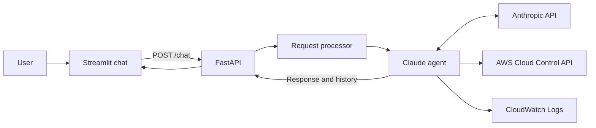

# Agentic AWS Resource Management

A Python learning project that connects a conversational Claude agent to AWS. A Streamlit chat interface sends requests to FastAPI; the agent chooses a tool, runs an AWS operation, and explains the result in natural language.

The current implementation uses the Anthropic Python SDK with `claude-haiku-4-5`, boto3, AWS Cloud Control API, and CloudWatch Logs.

> This app can create real AWS resources and incur AWS and Anthropic charges. Run locally against a sandbox AWS account with scoped permissions. The backend has no authentication or enforced approval workflow.

## What works today

| Capability | Current behavior |
| --- | --- |
| Natural language chat | Claude receives the conversation and two tool definitions. |
| Create a resource | Submits a Cloud Control request and returns a request token internally. Completion is asynchronous. |
| List resources | Returns up to five descriptions from the first Cloud Control response page. |
| Read a resource | Uses a resource type and identifier with Cloud Control. |
| Inspect Lambda errors | Filters `/aws/lambda/<name>` for `ERROR`, with a configurable lookback and up to ten returned events. |
| Explain tool results | Makes an additional Claude call for each executed tool to summarize its result. |
| Conversation history | Stores messages in the current Streamlit session and sends history with each request. |

The tool schema also advertises `update` and `delete`, but their execution branches are **not implemented**. Resource support depends on Cloud Control's supported types, properties, region, and the AWS identity's permissions.

## Architecture



Each chat request constructs a new agent and checks AWS identity through STS. Claude returns text or requests a tool. The agent executes recognized tools and asks Claude to summarize their results.

## Project structure

```text
agentic-aws-resource-management/
├── backend/
│   ├── api/main.py           # FastAPI application and HTTP endpoints
│   ├── config/aws_config.py  # Environment loading and boto3 sessions
│   ├── config/prompt.py      # Agent instructions and summary prompt
│   ├── core/aws_agent.py     # Claude calls, tool dispatch, AWS operations
│   ├── core/processor.py     # API-to-agent bridge
│   └── tools/tools.json      # Claude tool schemas
├── frontend/chat.py         # Streamlit chat and session history
├── .env.example             # Configuration template without credentials
├── .gitignore
├── Agent.md                 # Maintainer reference
├── documentation.md         # Extended learning guide
├── documentation.pdf        # Existing PDF version of the learning guide
├── requirements.txt
└── README.md
```

## Run locally

### Prerequisites

- Python 3.11 or newer is recommended; use a virtual environment.
- An Anthropic API key with access to the model configured in `backend/core/aws_agent.py`.
- An AWS sandbox account and credentials or a configured AWS SDK credential source.
- Permissions for the specific Cloud Control/resource operations and CloudWatch log groups you intend to use.
- AWS CLI is optional, for inspecting asynchronous request status.

### 1. Clone and install

```bash
git clone https://github.com/harshgavandit/agentic-aws-resource-management.git
cd agentic-aws-resource-management
python -m venv .venv
```

Activate on Windows PowerShell:

```powershell
.\.venv\Scripts\Activate.ps1
```

Activate on macOS/Linux:

```bash
source .venv/bin/activate
```

Then install:

```bash
python -m pip install -r requirements.txt
```

If PowerShell blocks activation, invoke `.\.venv\Scripts\python.exe` directly in the commands below.

### 2. Configure the environment

Copy the template on Windows:

```powershell
Copy-Item .env.example .env
```

Or on macOS/Linux:

```bash
cp .env.example .env
```

Fill in your values locally:

| Variable | Purpose |
| --- | --- |
| `ANTHROPIC_API_KEY` | Required for Claude calls. |
| `AWS_ACCESS_KEY_ID` | Access key if using explicit AWS credentials; leave unset for another SDK credential source. |
| `AWS_SECRET_ACCESS_KEY` | Secret key corresponding to the access key. |
| `AWS_SESSION_TOKEN` | Required when using temporary AWS credentials. |
| `AWS_DEFAULT_REGION` | boto3 session region; defaults to `us-east-1`. |

The app loads `.env` using `python-dotenv`. The model and frontend API URL are currently set in source. Cloud Control uses the tool's `region` argument, defaulting to `us-east-1`; CloudWatch uses the boto3 session region. The system prompt also states `us-east-1`, so keep these settings aligned.

Never commit `.env`, access keys, session tokens, or private AWS configuration. `.env.example` contains blank credential fields and can be committed.

### 3. Configure AWS permissions

Use only permissions needed for your chosen demo. Cloud Control IAM actions use the `cloudformation:` prefix, including `cloudformation:CreateResource`, `cloudformation:GetResource`, and `cloudformation:ListResources`. Underlying resource handlers also need service permissions for the resource being managed. Lambda error queries call `logs:FilterLogEvents`.

Review the official [Cloud Control security guidance](https://docs.aws.amazon.com/cloudcontrolapi/latest/userguide/security.html) when defining the policy. This repository does not provide a universal production IAM policy or custom assume-role implementation.

### 4. Start both services

From the repository root, start the backend:

```bash
python -m uvicorn backend.api.main:app --reload --host 127.0.0.1 --port 8000
```

In a second terminal, activate the same virtual environment and start the frontend:

```bash
python -m streamlit run frontend/chat.py --server.address 127.0.0.1 --server.port 8501
```

Open:

- Chat: <http://localhost:8501>
- API documentation: <http://localhost:8000/docs>
- Basic API health response: <http://localhost:8000/>

## API contract and examples

`GET /` returns:

```json
{"message": "FastAPI is running"}
```

This confirms that the web application responds; it does not validate AWS or Anthropic connectivity.

`POST /chat` accepts:

```json
{
  "message": "List my S3 buckets in us-east-1",
  "history": []
}
```

It returns `response` (assistant text) and `updated_history` (the message list). Example prompts:

- "List my S3 buckets in us-east-1."
- "Read the configuration of S3 bucket <bucket-name> in us-east-1."
- "Show ERROR logs for Lambda function <function-name> over the last 2 hours."
- "Create an S3 bucket named <globally-unique-name> in us-east-1 with versioning enabled."

These illustrate usage; they are not recorded successful cloud operations.

## Asynchronous creation

An accepted create request is not proof that provisioning finished. The app does not poll to completion, and the UI receives a generated summary rather than a dedicated raw Cloud Control result panel.

When you have the request token, inspect its status:

```bash
aws cloudcontrol get-resource-request-status --request-token <request-token> --region us-east-1
```

See AWS's [request progress documentation](https://docs.aws.amazon.com/cloudcontrolapi/latest/userguide/resource-operations-manage-requests.html). Inspect final status and clean up sandbox resources after testing.

## Troubleshooting

| Symptom | What to check |
| --- | --- |
| `ModuleNotFoundError` | Activate the correct environment, install requirements, and run from the repository root. |
| Frontend cannot reach backend | Start FastAPI on port 8000; the frontend calls `http://localhost:8000/chat`. |
| `AWS connection failed` | Check credentials, temporary session token, credential source, region, and STS connectivity. |
| Anthropic authentication/model/quota error | Check the key, configured model access, billing, and returned error. |
| AWS `AccessDenied` or unsupported resource | Check Cloud Control and resource-specific permissions, type support, and region. |
| Lambda log group is missing | Check function name, session region, and whether the function has emitted logs. |
| Creation is reported as initiated | Inspect the Cloud Control request's final status. |

## Current limitations

- No backend authentication, authorization layer, or enforced user approval before cloud writes. Prompt instructions are not an authorization control.
- CORS allows all origins; bind the demo to localhost.
- Update/delete are advertised but not executed.
- Responses are not paginated. Lists show at most five descriptions; log queries show at most ten events from the fetched response.
- History is not persisted, trimmed, or deduplicated. The frontend adds the user message and the agent appends it again.
- Blocking SDK calls run inside an asynchronous API handler. There are no application-level retries, frontend request timeout, or streaming responses.
- AWS responses and log content may appear in console output and be sent to Anthropic for summaries. Use suitable demo data.
- Dependencies use minimum or unpinned versions. There is no lockfile or comprehensive automated test suite.

## Documentation and development

Read [Agent.md](Agent.md) for the source map and [documentation.md](documentation.md) for the extended learning guide. [documentation.pdf](documentation.pdf) is the existing exported guide. The README and current source are the reference for implemented behavior; guide examples illustrate concepts.

Basic source checks:

```bash
python -m compileall -q backend frontend
python -m json.tool backend/tools/tools.json
git diff --check
```

Cloud integration testing requires valid credentials and can incur charges. Health and syntax checks alone do not establish that provisioning or Claude generation works.

Potential next steps: request-status polling, update/delete with enforced approvals, authentication, scoped IAM examples, pagination, history management, and mocked integration tests.

## Project origin

Based on [sanjayssnit/agentic-aws-resource-management](https://github.com/sanjayssnit/agentic-aws-resource-management). Original commit history is retained alongside the reorganized backend/frontend layout and local project documentation. No new license is assigned by this publication.
